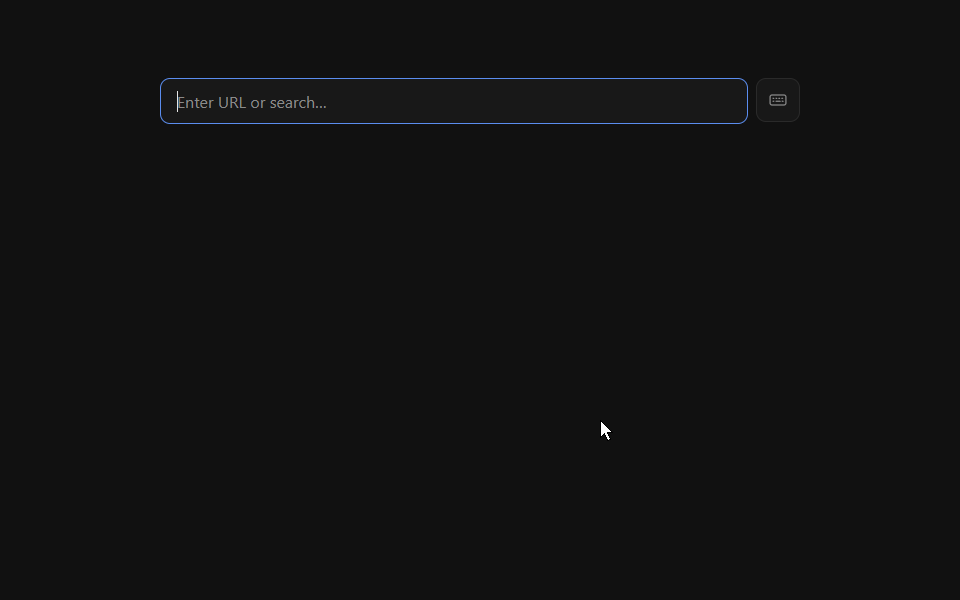

# mini-browser

A minimal, dark, chrome-less Chromium browser for screen sharing, streaming and quick tests, without the bloat and state of your everyday browser.



**[Download](https://github.com/montesgp/mini-browser/releases/latest)** · [For humans](#for-humans) · [For agents and contributors](#for-agents-and-contributors) · [Contributing](CONTRIBUTING.md)

---

# For humans

## What it is

- **Just the page.** No toolbar, no address bar, no title bar: the website sits inside a thin dark frame, so what you share is only what matters.
- **Tabs and window buttons when you reach for them.** Move the mouse to the top of the window, over the strip where the bar sits, and a thin bar slides in with your tabs, a `+` for a new tab, a pin, and the minimize, maximize and close buttons. The page slides down below it, whole and without redrawing, so the bar never covers a site's menu; only the page's bottom edge is out of view while the bar shows. It hides again when the mouse leaves, or stays if you pin it.
- **A calm start page.** New tabs open a dark home page with one field: type an address or a search and press `Enter`. On any other page, press `Ctrl+L` (`Cmd+L` on Mac) to type an address; the box disappears again.
- **Separate from your browser.** Its own cookies and history, nothing from your everyday browser shows up in a meeting.
- **Real Chromium, with its security on.** Same engine as Chrome, with Chromium's sandbox enabled.

## Download and run

Get the file for your computer from the **[latest release](https://github.com/montesgp/mini-browser/releases/latest)** (every older version stays on the [Releases page](https://github.com/montesgp/mini-browser/releases)):

| Your computer | Download | Then |
| --- | --- | --- |
| Windows | `…-windows-x64.zip` | Extract it and open `minibrowser.exe`. |
| Mac (Apple Silicon) | `…-macos-arm64.zip` | Extract it, move `minibrowser.app` to Applications and open it. |
| Linux | `…-linux-x64.tar.gz` | Extract it and run `./minibrowser`. |

The first time, your system may warn you because the app is not code-signed yet (see [Code signing policy](#code-signing-policy)):

- **Windows:** Microsoft Defender SmartScreen shows "Windows protected your PC" for new unsigned apps. Click **More info → Run anyway**. To skip the prompt, before extracting right-click the downloaded `.zip` → **Properties** → tick **Unblock** → **OK**. You can check the file first, see [Verifying downloads](#verifying-downloads).
- **Mac:** if it will not open, allow it under **System Settings → Privacy & Security**.
- **Linux:** if it stops with a sandbox error, see [Linux sandbox setup](#linux-sandbox-setup).

Keep the extracted folder together: the app needs the files next to it.

## Using it

| To | Windows / Linux | Mac |
| --- | --- | --- |
| Type an address or search | `Ctrl+L` | `Cmd+L` |
| Open a new tab | `Ctrl+T` | `Cmd+T` |
| Close the tab (the last one closes the window) | `Ctrl+W` | `Cmd+W` |
| Switch tabs | `Ctrl+Tab` / `Ctrl+Shift+Tab` | `Ctrl+Tab` / `Ctrl+Shift+Tab` |
| Go to tab 1 to 8, or the last tab | `Ctrl+1` … `Ctrl+8`, `Ctrl+9` | `Cmd+1` … `Cmd+8`, `Cmd+9` |
| Pin or unpin the top bar (tabs and window buttons) | `Ctrl+Shift+F` | `Cmd+Shift+F` |
| Back / forward | `Alt+Left` / `Alt+Right` | `Cmd+[` / `Cmd+]` |
| Reload | `Ctrl+R` | `Cmd+R` |
| Settings: frame size (`+` and `-` while open), top bar `Auto` or `Pinned` | `Ctrl+,` | `Cmd+,` |
| Quit | `Ctrl+Q` | `Cmd+Q` |

Drag the dark frame to move the window, double-click it to maximize or restore, and drag its edges to resize. A maximized window has no frame, like any other window; restored, the frame comes back. Type a website (`github.com`) or any words to search.

- **The home page lists every shortcut.** The small keyboard button next to its field opens a card with each shortcut (`Ctrl` or `Cmd` for your system) and its action; click a row to run it, use `−` and `+` to change the frame size, or click the top bar row to switch between `Auto` and `Pinned`. A click outside the card or `Esc` closes it, and it stays open or closed as you left it. It shows the current settings even when you change them elsewhere, like with the bar's pin. `Tab`, `Enter` and `Space` work too.
- **Back from the first page returns to the home page**, with `Alt+Left` (`Cmd+[` on Mac), the mouse back button or the right-click menu. Tabs that start on a page (`--url=…` or a pop-up) have nothing to go back to.
- **A thin blue line moves along the top of the frame** while the page loads.
- **The window is always called `mini-browser`**, so the taskbar, `Alt+Tab` and a meeting's share picker never show the title of the page you have open.
- **The top bar shows where you are.** Click a tab to switch to it; in `Auto` the bar then hides at once so the page is whole again, and shows again when you move the mouse away from the top and back. The bar also shows for a moment when you open, close or switch tabs from the keyboard.
- **Close a tab with its `×`.** The current tab and the tab under the mouse show a small `×` that closes that tab, like `Ctrl+W` (`Cmd+W` on Mac): closing the last tab leaves a home page, so the app only quits from the window's close button, `Alt+F4` (`Cmd+Q` on Mac), `Ctrl+Q` or the home page's quit row. On Windows a middle click on a tab closes it too. The `+` after the last tab opens a new one at the end, like `Ctrl+T` and the home page's "New tab" row; tabs that pages open, and addresses sent with `--url=…`, open right after the current tab. Long titles end in `…`; with more tabs than fit, it shows the ones around the current tab and how many are hidden (`+3`).
- **Drag tabs to reorder them (Windows).** Press a tab and drag it left or right; it moves among the shown tabs as you go and stays where you release it. A press without moving still just switches to the tab. On macOS and Linux tabs keep their order and close only with `×` for now.
- **`Auto` or `Pinned`.** By default (`Auto`) the bar only shows on hover, so a shared screen stays clean. `Pinned` keeps it always visible, with the page below it. Click the pin in the bar, choose in settings (`Ctrl+,`) or press `Ctrl+Shift+F`; the choice is remembered. On Linux the bar does not follow the mouse yet: in `Auto` it shows only when tabs change, so pin it to reach the buttons.
- **The settings box stays out of the way.** It opens in the bottom-right corner of the page, so it does not cover search fields at the top or center of pages. Close it with its `×`, a click outside it (on the page, a tab, the frame or the bar), `Esc` or `Ctrl+,` again (`Cmd+,` on Mac).
- **Starting it again brings the open window to the front** instead of opening a second one. Started with an address (`--url=github.com`), it also opens that address in a new tab.
- **Open a file from your computer.** Type its path in the home page's field or the `Ctrl+L` box (`C:\Users\you\Downloads\page.html` on Windows, `/Users/you/page.html` or `~/page.html` on Mac and Linux), or a `file:///` address, start the app with `--url` and the path, or drop the file (a page, PDF or image) on the window to open it in the current tab. Files on other computers (`\\server\share\…`) are not opened; that text becomes a search. Websites cannot open your files.

## Good to know

- **Camera, microphone and location requests are not granted.** It is made for showing pages, not for joining calls; use your main browser for those.
- **Pop-ups open as tabs, a few at a time.** Pages can open at most 3 pop-up tabs every 2 seconds in total, so nothing can flood your window.
- **No downloads, printing or find-in-page** yet.
- **Keep it updated.** Each release ships a recent Chromium; newer releases carry its security fixes.

## Credits

mini-browser is inspired by **Mini**, the personal web browser built by [Guillermo Rauch](https://rauchg.com/). His idea, a browser that gets out of the way when you share your screen, and his move from Electron to Rust with the `cef` crate shaped this project. Thank you, Guillermo.

Built on [cef-rs](https://github.com/tauri-apps/cef-rs) (the `cef` crate, by the Tauri team), the [Chromium Embedded Framework](https://bitbucket.org/chromiumembedded/cef) and Chromium.

## License and contributing

Free and open source under [MIT](LICENSE-MIT) or [Apache-2.0](LICENSE-APACHE), at your option. Found a bug or have an idea? [Open an issue](https://github.com/montesgp/mini-browser/issues/new/choose). Want to help? Read [CONTRIBUTING.md](CONTRIBUTING.md).

---

# For agents and contributors

This part is written for AI coding agents and developers working on or with this repository. Agents should also read [AGENTS.md](AGENTS.md), which lists the rules to follow when changing code here.

## Repository map

| Path | What it holds |
| --- | --- |
| `crates/core` (`mini-core`) | Platform-independent logic with unit tests: address resolution, tab model (with per-tab loading state), settings, shortcut table, home page routes and commands, pop-up throttle, window geometry, tab strip layout, top bar visibility, window registry and quit rule. |
| `crates/app` (`minibrowser`) | The CEF Views shell: window, address box, tabs, top bar (tab strip and window buttons), settings box, loading line, the `mini` scheme and the home page handler. |
| `crates/app/home` | The home page's `index.html`, `home.css` and `home.js`, embedded in the app with `include_str!`. |
| `xtask` | The `bundle` tool that builds the app and lays out a runnable CEF bundle (port of cef-rs `bundle-cef-app`, plus `--release` on macOS). |
| `assets/icon` | The app icon: `icon.svg` is the master; `icon.ico`, `icon.icns` and the PNGs are rasters of it. |
| `.github/workflows/build.yml` | CI on Windows, macOS and Linux; `ci-gate` is the single required check. |
| `.github/workflows/release.yml` | Tag-triggered release pipeline. |
| `odd/tasks/` | Feature specs and decision logs from development. |

## Build, test and bundle

Prerequisites on every platform:

- Rust (stable), via [rustup](https://rustup.rs/).
- CMake and Ninja on `PATH` (they compile CEF's C++ wrapper).
- A C++ toolchain: Visual Studio with the C++ workload on Windows (it bundles CMake and Ninja under `Common7\IDE\CommonExtensions\Microsoft\CMake`), Xcode command-line tools on macOS, `gcc`/`g++` on Linux.

```sh
# Checks (the same ones CI runs)
cargo fmt --all -- --check
cargo clippy --workspace --all-targets -- -D warnings
cargo test -p mini-core
cargo test -p minibrowser --lib   # app unit tests; they compile on the Windows sandbox build only for now

# Runnable bundle (debug); add --release for an optimized one
cargo run -p xtask --bin bundle -- minibrowser -o target/bundle
```

The first build downloads CEF (about 400 MB) into `target/`. To reuse one copy across `cargo clean` and checkouts, extract it once and set `CEF_PATH` (see the [cef-rs README](https://github.com/tauri-apps/cef-rs#install-shared-cef-binaries)).

| OS | Run the bundle |
| --- | --- |
| Windows | `target\bundle\minibrowser.exe` (CEF's `bootstrap.exe`, which loads `minibrowser.dll` sandboxed) |
| macOS | `open target/bundle/minibrowser.app` |
| Linux | `target/bundle/minibrowser` |

Start on a page with `minibrowser --url=<input>` (or `--url <input>`); the value goes through the same resolution as the address box (`mini_core::launch::url_input`). Launching again while the app runs is handled in `on_already_running_app_relaunch`: CEF forwards the new launch's command line, already cleared of user switches, to the running process; the app re-adds its own `--url` input in `on_before_command_line_processing` so it survives, and the running process only reads that input, opens it in a new tab when it resolves (`mini_core::launch::relaunch`) and brings the window to the front; the second process exits with code 0.

### App icon

The icon (a dark frame around a window, with the blue loading line on top) lives in `assets/icon`. `icon.svg` is the master, and the rasters are committed next to it: regenerate `icon.ico` (16 to 256 px), `icon.icns` (16 to 1024 px), `icon.png` (512 px), `icon-16.png` and `icon-32.png` from the SVG whenever it changes. Where each one goes:

- **Window and taskbar, every OS:** `crates/app/src/shell/window.rs` embeds the PNGs and sets them as the CEF window icon (16 px, with 32 px for 2x screens) and app icon (512 px).
- **Windows executable:** the bundle's `minibrowser.exe` is CEF's prebuilt `bootstrap.exe`, so the app's own build cannot give it an icon. `xtask` writes `icon.ico` into the copied executable's resources as the named icon group `MINIBROWSER`, which Explorer, shortcuts and pinned taskbar buttons pick before the bootstrap's generic icon.
- **macOS app bundle:** `xtask` copies `icon.icns` to `minibrowser.app/Contents/Resources` and sets `CFBundleIconFile` in `Info.plist` with `plutil`.

### Platform status

Windows is built, tested and exercised by hand. Linux (x64) was run by hand in WSL2 with WSLg (Ubuntu 26.04): it renders, and its renderers run inside Chromium's namespace and seccomp sandbox. macOS (Apple Silicon) compiles, passes tests and is bundled, but nobody has used it by hand yet. CI launches the real app on all three systems (`.github/scripts/smoke-test.sh`): it must stay up with its helper processes, and on Linux with seccomp-sandboxed children. Windows ARM64, Linux ARM64 and Intel Macs are supported by cef-rs but not built.

## Address resolution

Implemented in `crates/core/src/address.rs`:

- `http://` and `https://` input loads as typed.
- Host-like input gets `https://`: at least two dot-separated labels ending in an alphabetic or punycode TLD, no `@` in the authority (`github.com`, `vercel.com/home`, `medium.com/@user`). `localhost` and IP addresses get `http://`.
- Local files load as `file:///` URLs, with the platform passed in by the app (`LocalFiles`: `PathStyle::CURRENT` and, on macOS and Linux, `$HOME` for `~`):
  - `file:` URLs whose host is empty or `localhost` (`file:///C:/x.html`, `file://localhost/etc/hosts`); backslashes count as slashes, and the path is decoded and percent-encoded again, so it is canonical (`file:///C:/My%20Files/x.html`).
  - Windows: drive paths, `C:\x` or `C:/x`, any drive letter. macOS and Linux: absolute paths (`/x`, so a bare `/word` opens a file there and is a search on Windows) and `~` or `~/x` in the home directory.
  - Paths are percent-encoded byte by byte (UTF-8) except letters, digits and `-._~!$&'()*+,;=:@/`, so spaces, `#`, `?`, `%` and non-ASCII names open (`café#1.html` → `caf%C3%A9%231.html`).
  - Refused, so a search: UNC paths (`\\server\share`, `//server/share`), `file://host/…` with any other host (also `127.0.0.1` or with a port or user), paths that decode to another machine (`file:////server`, `file:///%5C%5Cserver`), relative paths (`Downloads\x.html`), drive-relative paths (`C:x`) and paths of the other platform.
- Everything else is a search through the configured template, including any other scheme (`javascript:`, `data:`, `chrome:`, and the app's own `mini:`). Empty input does nothing.
- **Dropped files** open through Chromium's default drop handling (the `DragHandler` lets drags through); the address box rules do not apply to them because the user picked the file.
- **Navigation guard** (`MiniRequestHandler` in `crates/app/src/shell/client.rs`): `on_before_browse` cancels redirects into `file:` (Chromium already refuses them with `ERR_UNSAFE_REDIRECT`) and every navigation to a file on another machine (`mini_core::address::is_remote_file_url`); `get_resource_request_handler` cancels images, scripts and other requests for such files, which a local page could otherwise make. On Windows those would open the share and could send the user's credentials to its server.

## Home page

New tabs load `mini://home/`, so it is the first entry of their history and Back from the first page returns to it. `mini` is a custom scheme registered in every process type (`crates/app/src/scheme.rs`: the browser process's app, and `SubprocessApp` for the renderer, GPU and utility processes, also in the macOS helper) as standard, secure, display-isolated and fetch-enabled: the home page is a normal origin with its own storage, and web pages cannot link to it or frame it. A server redirect is not checked against the page that started the navigation, so `MiniRequestHandler::on_before_browse` (`crates/app/src/shell/client.rs`) cancels every redirect into `mini:`; the tab keeps its previous page, or stays empty when it had none.

- **Files:** `crates/app/src/shell/home.rs` registers a scheme handler factory for `mini://home/` that serves the embedded files with `Content-Security-Policy: default-src 'none'; script-src 'self'; style-src 'self'; img-src 'self' data:; connect-src 'self'; frame-ancestors 'none'; base-uri 'none'; form-action 'none'` and `X-Frame-Options: DENY`. Nothing remote loads; fonts are the system's.
- **Command bridge:** the page calls `fetch('/cmd/<name>')` on its own origin. `mini_core::home::route` maps the URL to a fixed list (`go?input=`, `new-tab`, `close-tab`, `next-tab`, `previous-tab`, `back`, `forward`, `reload`, `top-bar`, `padding?step=-1|1`, `quit`) plus `state`; anything else is `404`, and so is a document request (navigation or frame) to `state` or a command, which only `fetch` may call. A command runs only when the request is a `GET` `fetch` from a main frame showing the home document, `mini://home/` or `mini://home/index.html` (`mini_core::home::is_home_url`, checked on the IO thread) and its browser is the active tab, still on the home page (checked on the UI thread, where the command runs through `commands::run`, `settings_box::step` or `tabs::navigate_active`); otherwise the reply is `403` and nothing runs. Every answer is the state JSON `{"platform", "padding", "topBar"}`.
- **Input:** `go` resolves its input with `resolve_input`, so `mini://home/cmd/quit` typed in the field is a search and a local path opens the file.
- **Shell integration:** the tab strip shows `New tab` for the home page and no loading line; `Ctrl/Cmd+L` on the home page focuses its field (`Frame::execute_java_script` calls `window.miniFocusAddress`) instead of opening the address box.

## Settings file

`settings.json` in the app data directory (`crates/core/src/settings.rs`):

| OS | App data directory |
| --- | --- |
| Windows | `%LOCALAPPDATA%\minibrowser` |
| macOS | `~/Library/Application Support/minibrowser` |
| Linux | `$XDG_DATA_HOME/minibrowser` (default `~/.local/share/minibrowser`) |

```json
{
  "padding": 8,
  "searchTemplate": "https://www.google.com/search?q={query}",
  "topBar": "auto"
}
```

- `padding`: frame width in pixels, 4 to 32 (default 8, 2 px per settings-box step). Out-of-range integers are clamped.
- `searchTemplate`: an `http(s)` URL containing `{query}`. Anything else falls back to Google.
- `topBar`: `"auto"` (default) or `"pinned"`. Any other value means `"auto"` and leaves the other settings intact.
- A corrupt file yields defaults and stays untouched until a setting changes, which rewrites it atomically.

The same directory holds the browser profile (`profile/`). If no app data directory can be determined, the app exits with an error (a dialog on Windows) instead of using a shared temporary folder. If saving settings fails, the settings box says so and the change applies until restart.

## Windows and per-window state

The app opens one window today, but the shell keeps no single-window state. `crates/app/src/shell/windows.rs` is a registry of `WindowState` entries keyed by `WindowId` (`mini_core::windows::Windows`, which also tracks the last active window). Each entry holds its window's frame, tabs, top bar, tab strip, address box, settings box, loading line, popup throttle and, on Windows, the mouse hook's window handle and gesture, each in its own `RefCell`, so modules keep borrowing only their own part. Window delegates, overlay buttons and posted tasks carry their `WindowId`; browser callbacks (titles, loading, keys, popups, home commands) find their window by the browser (`windows::of_browser`). Settings are the app's (`settings_box::init`) and every change applies to every window. The registry also lists the app's open browsers: the app quits when no browser is left and no window is still running (`mini_core::windows::app_quits`), so closing a window's last tab still opens a home tab in its place. A relaunch opens its tab in the last active window.

## Top bar

The top bar (`crates/app/src/shell/top_bar.rs`) is a window overlay below the frame's top side, holding the tab strip (`tab_strip.rs`) and the window buttons, which call the CEF `Window` API (`minimize`, `maximize`, `restore`, `close` through the tabs' close sequence). The bar never covers the page; `mini_core::top_bar::room` decides how the page makes room. In `Pinned` a spacer of the bar's height sits in the window layout, so the page shrinks below the bar. In `Auto` the revealed bar moves the page down by its height without resizing it (`window::shift_pages` gives the tabs' container a box layout with a top inset and an equal negative bottom inset, and the container clips the page's bottom), because resizing the page made Chromium lay it out and repaint it, a visible flash, each time the bar came and went. A hidden bar leaves nothing on the page. The bar also holds a `+` new-tab button after the last tab and a pin button that switches `Auto`/`Pinned` through the same saved setting as the settings box and `Ctrl/Cmd+Shift+F`.

- **Visibility rules** live in `mini_core::top_bar`, a time-injected state machine: the area the bar occupies when shown (the frame's top side plus the bar's height across the window's width, measured from the screen's edge when a maximized window reaches past it) reveals the bar, the bar's area keeps it while shown, it hides 0.5 s after the pointer leaves, and tab changes flash it for 1.5 s (not the first tab). Clicking a tab calls `TopBar::dismiss` after the activation's flash: the auto-mode bar hides at once and stays hidden until the pointer is away from the edge and the bar's area, or the next flash.
- **Closing from the strip:** each tab is a panel with its title and a `×` button (shown on the active tab and, tracked from the buttons' hover states, on the hovered one; the title gives up the button's width, so the tab keeps the width `strip_layout` gave it). The `×` closes that tab's browser through the same `close_browser` path as `Ctrl/Cmd+W`. Views passes no event flags to `on_button_pressed` and its buttons react only to the left button, so middle clicks and drags come from a mouse hook (below).
- **Mouse hook (Windows only):** `mouse_hook.rs` installs `SetWindowsHookExW(WH_MOUSE, …, GetCurrentThreadId())` when the first window is created, a hook on the app's own UI thread (not a low-level or global hook), and removes it when the last window is destroyed. It only reads messages whose target's root window is an app window (each gesture belongs to that window), always calls `CallNextHookEx`, and runs each gesture in a posted task. Screen points become window coordinates through `window::origin_in_screen`, and tabs are hit-tested from the strip layout (`mini_core::strip::tab_at`) while the bar is shown. Middle button down and up on the same tab closes it (`tabs::close`); a left press on a tab that moves more than `strip::DRAG_THRESHOLD` (5 px) becomes a drag that activates the tab and moves it live (`Tabs::move_tab`, the strip rebuilt) to the shown position nearest its label's center (`strip::drag_index`), until the button is up; a shorter press stays a normal click. A left click on the frame or the shown bar closes the settings box (`layout::click_closes_box`), which page and tab clicks already do through the focus. macOS and Linux have no hook yet: no middle-click close, no drag to reorder.
- **New tab placement:** `Ctrl/Cmd+T`, the `+` and the home page's "New tab" row append the tab (`Tabs::open_at_end`); popups and `--url` relaunch tabs go right after the active tab (`Tabs::open`). The shell keeps its browser views in the model's order.
- **Pointer:** CEF Views reports no mouse moves over a browser view, so a 100 ms timer (`post_delayed_task`) reads the cursor: `GetCursorPos` on Windows (ignored when `WindowFromPoint` finds another window on top), `NSEvent::mouseLocation` on macOS. Linux has no pointer query yet, so in `Auto` the bar shows only on tab changes there (TODO in `top_bar.rs`); it never stays visible unless pinned.
- **Dragging:** the frame and the bar's empty area right of the tabs are draggable regions; tabs and buttons are not, so they get clicks. Double-click maximize and restore come from the OS caption behavior of those regions.
- **Overflow:** `mini_core::strip::strip_layout` reserves room for the `+` button and for the `+N` count when tabs are hidden.
- **Maximized:** the frame padding is 0 while the window is maximized (`mini_core::layout::frame_padding`) and the saved padding returns on restore; `window::origin_in_screen` reads the window's client area from Windows (`GetWindowInfo`), where the views start, because CEF's conversions are off for a maximized frameless window, whose client area sits inside a frame that reaches past its screen, on screens that do not start at (0, 0).
- **Last tab:** closing the only tab opens a home tab in its place; quitting stays on the window close button, `Alt+F4`, `Ctrl/Cmd+Q` and the home page's quit row.

## Security model

- **Sandbox on** on every platform. On Windows the bundle runs through CEF's `bootstrap.exe`, which hosts the app's DLL so renderer, GPU and utility processes start sandboxed.
- **Isolated profile** in the app data directory.
- **No debugging backdoors:** no remote debugging port, no flag that weakens web security, and Chromium/CEF switches given on the command line are ignored (`Settings.command_line_args_disabled`), so a launch with `--no-sandbox` or `--remote-debugging-port` has no effect, also when it is a second launch handed to the running app. The app reads its own `--url` before CEF initializes; its built-in switches are added in `on_before_command_line_processing`.
- **Local files only from the user:** the address box, the home page's field, `--url` and a dropped file open local files; web pages cannot navigate, redirect or frame `file:` (Chromium's rule, which the app does not relax: no `allow_file_access_from_file_urls`). Files on other machines (UNC paths, `file://host/…`) are never opened, typed or requested by a page, because on Windows that can send the user's credentials to the host (see [Address resolution](#address-resolution)).
- **Home page bridge:** the `mini://home/` page can ask the app to run only its listed commands, and only from the active tab's main frame while it shows the home page; web pages and local `file:` pages cannot link to, frame, `fetch` or redirect to it (see [Home page](#home-page)).
- **Pop-up throttle:** pop-ups become tabs, at most 3 per window every 2 seconds, shared by all pages so a chain of pop-ups cannot reset it (`mini_core::popups::PopupThrottle` with one key); extra ones are cancelled and logged to stderr.
- **No permission prompts:** tabs use CEF's Alloy runtime style (CEF allows one Chrome-style browser per window), which has no permission UI, and no permission handler is registered, so camera, microphone, location and similar requests are not granted.

Trade-offs:

- **No Google Safe Browsing** in CEF.
- **Updates are on us.** Chromium is bundled; staying secure means bumping the `cef` crate and releasing whenever a Chromium security release lands ([cef-rs releases](https://github.com/tauri-apps/cef-rs/releases)).
- **Windows rendering flag:** the browser process runs with `--disable-features=CalculateNativeWinOcclusion`, because occlusion tracking kept the frameless window from being drawn. Rendering only; no web-security effect.

Report vulnerabilities privately: see [SECURITY.md](SECURITY.md).

### Linux sandbox setup

On distributions that restrict unprivileged user namespaces (for example Ubuntu 23.10 and later), Chromium's sandbox helper must be owned by root and setuid. If the app exits with a sandbox error, run this in the extracted folder; do not disable the sandbox instead:

```sh
sudo chown root:root chrome-sandbox && sudo chmod 4755 chrome-sandbox
```

## Code signing policy

Windows releases are not code-signed yet. We have applied to [SignPath Foundation](https://signpath.org) for free code signing for open-source projects; while that is pending, every release can be checked with its checksums and build-provenance attestation (see [Verifying downloads](#verifying-downloads)). Once approved, this section will read: Free code signing provided by [SignPath.io](https://about.signpath.io), certificate by [SignPath Foundation](https://signpath.org).

- **Builds:** every release archive is built from this repository by [`release.yml`](.github/workflows/release.yml) on GitHub-hosted runners, from a tag on `main`.
- **Team roles:** committers and reviewers: [@montesgp](https://github.com/montesgp); approvers (who approve each release for signing): [@montesgp](https://github.com/montesgp). Changes from anyone else land only through reviewed pull requests.
- **Privacy:** mini-browser has no telemetry, analytics or accounts, and its own code sends nothing anywhere you did not ask for. It loads the pages you open; text you type that is not an address is sent as a search to the configured search engine (Google by default, under [Google's privacy policy](https://policies.google.com/privacy)). Its web engine, [CEF](https://bitbucket.org/chromiumembedded/cef)/Chromium, may make the network requests that browsing itself needs, such as certificate checks.

## Verifying downloads

Each release has `SHA256SUMS.txt` and a signed build-provenance attestation per archive:

```sh
sha256sum -c SHA256SUMS.txt --ignore-missing         # macOS: shasum -a 256 -c SHA256SUMS.txt
gh attestation verify mini-browser-vX.Y.Z-linux-x64.tar.gz -R montesgp/mini-browser
```

On Windows, compare `Get-FileHash <file>` with the matching line. On macOS, `xattr -dr com.apple.quarantine /Applications/minibrowser.app` removes the download quarantine flag if Gatekeeper refuses the unsigned app.

## Versioning and releases

[Semantic Versioning](https://semver.org/) (`MAJOR.MINOR.PATCH`; while `0.x`, a minor bump may change behavior). The single version source is `version` under `[workspace.package]` in `Cargo.toml`; every release is recorded in [CHANGELOG.md](CHANGELOG.md).

To cut a release:

1. Move the `Unreleased` notes in `CHANGELOG.md` under `## [X.Y.Z] - YYYY-MM-DD` and update the links at the bottom.
2. Set `version = "X.Y.Z"` in `Cargo.toml` and run `cargo check` so `Cargo.lock` follows.
3. Merge to `main` through a PR, then tag and push:

   ```sh
   git tag -a vX.Y.Z -m "mini-browser vX.Y.Z"
   git push origin vX.Y.Z
   ```

[`release.yml`](.github/workflows/release.yml) checks that the tagged commit is on `main`, that the tag matches `Cargo.toml` and that `CHANGELOG.md` has the section, builds optimized bundles on Windows (x64), macOS (arm64) and Linux (x64), attests their provenance, and publishes them with `SHA256SUMS.txt` as GitHub Release `vX.Y.Z`, using the changelog section as release notes.

## Contribution workflow

Only the owner ([@montesgp](https://github.com/montesgp)) merges external contributions; the owner's own coding agents merge their PRs once `ci-gate` is green on the head commit. Everyone else forks, branches from `main`, and opens a pull request; `main` accepts changes only through PRs with a green `ci-gate`. Details in [CONTRIBUTING.md](CONTRIBUTING.md); conduct rules in [CODE_OF_CONDUCT.md](CODE_OF_CONDUCT.md).

## License

Dual-licensed under [MIT](LICENSE-MIT) or [Apache-2.0](LICENSE-APACHE), at your option. Release builds bundle CEF and Chromium under their own licenses: see [THIRD_PARTY_NOTICES.md](THIRD_PARTY_NOTICES.md) and the `CREDITS.html` inside each archive. Unless you explicitly state otherwise, any contribution you intentionally submit for inclusion, as defined in the Apache-2.0 license, is dual-licensed as above, without any additional terms or conditions.
